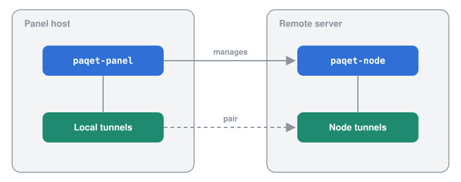
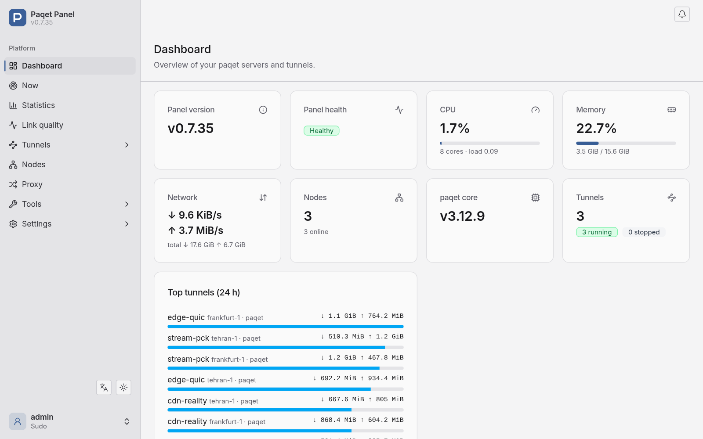
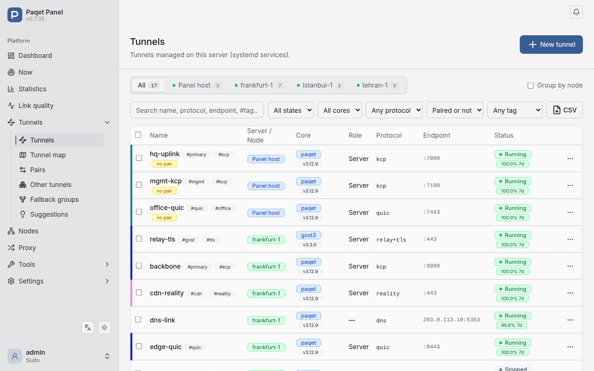
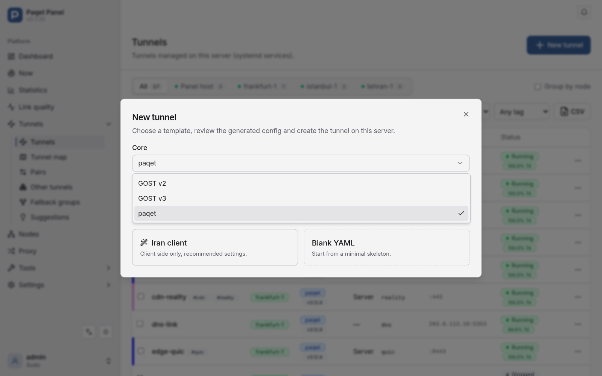
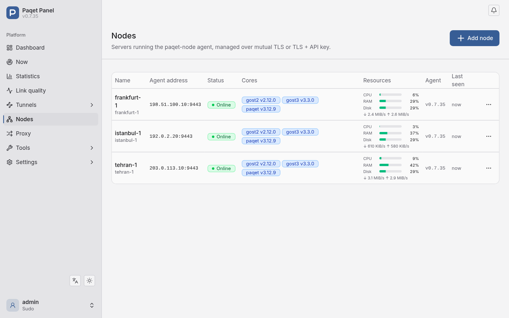
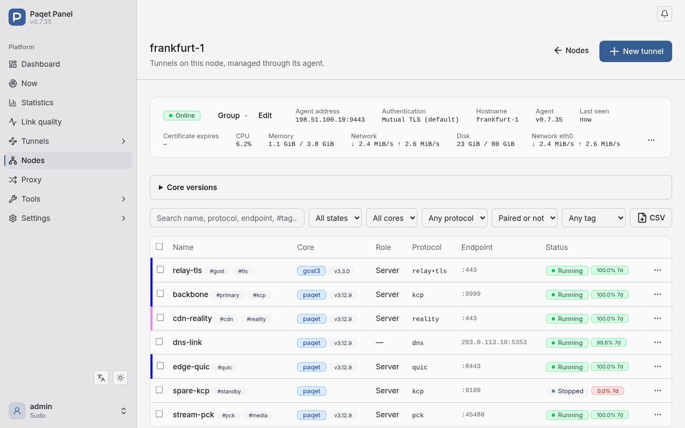
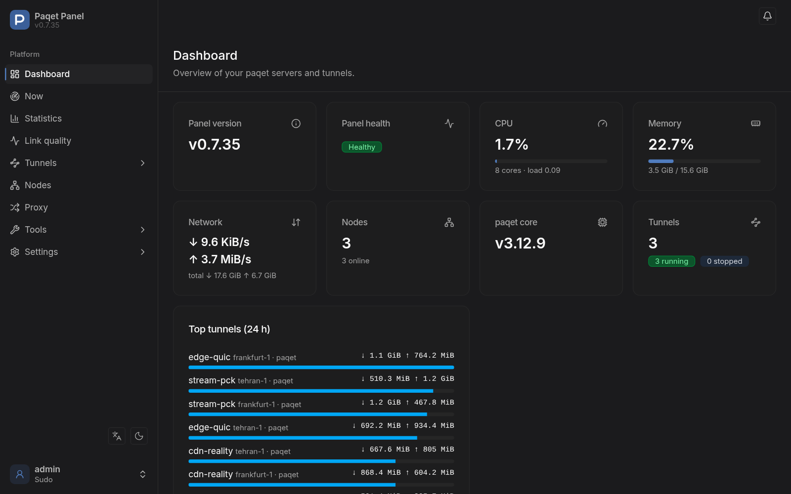
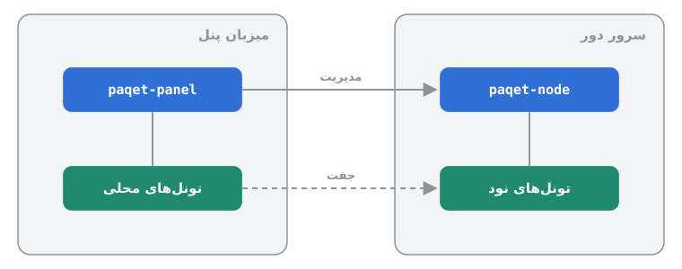
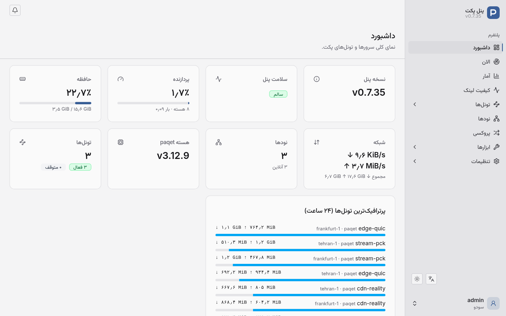
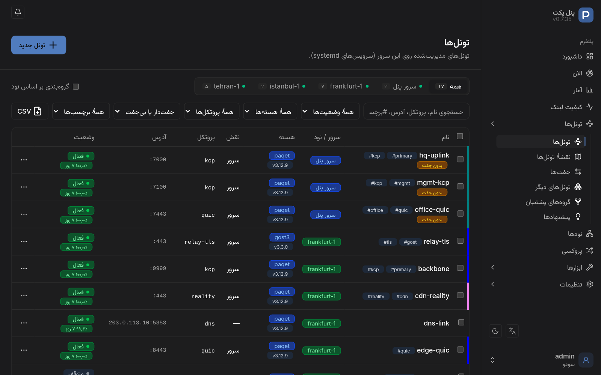

<div align="center">


<h3>A web panel for managing paqet and gost tunnels</h3>

[](https://github.com/amir12120/Paqet-AMIR)
[](LICENSE)
[](#-requirements)
[](https://go.dev/)

**English** &nbsp;|&nbsp; [فارسی](#فارسی)

[🚀 Quick start](#-quick-start) &nbsp;·&nbsp; [✨ Features](#-features) &nbsp;·&nbsp; [📸 Screenshots](#-screenshots) &nbsp;·&nbsp; [📦 Installation](#-quick-start)

</div>

---

> [!NOTE]
> **This repository** (`amir12120/Paqet-AMIR`) is an independent copy of paqet-panel v0.7.44. It was split off the GitHub fork network so it can be developed on its own, and it carries the installer and these docs. Its releases carry the installer; the release files (panel, node agent, Caddy, `uninstall.sh`) still come from the upstream project and are verified against `SHA256SUMS`. Publish a full release here and that fallback ends. Licenses and third-party notices are unchanged: see [LICENSE](LICENSE) and [NOTICE](NOTICE).

---

## English

<details>
<summary><b>📑 Contents</b></summary>

- [🚀 Quick start](#-quick-start)
- [✨ Features](#-features)
- [🧩 How it fits together](#-how-it-fits-together)
- [📸 Screenshots](#-screenshots)
- [📦 Advanced: non-interactive install (flags)](#-advanced-non-interactive-install-flags)
- [🚩 Installer flags](#-installer-flags)
- [🔗 Node setup](#-node-setup)
- [🔄 Updating](#-updating)
- [🧹 Uninstalling](#-uninstalling)
- [📋 Requirements](#-requirements)
- [🧱 Ports and firewall](#-ports-and-firewall)
- [📁 Files and services](#-files-and-services)
- [💾 Backup and restore](#-backup-and-restore)
- [🩺 Troubleshooting](#-troubleshooting)
- [🔐 Security notes](#-security-notes)
- [📄 License](#-license)

</details>

### 🚀 Quick start

On a Linux server (x86-64, ARM64, ARMv7, 32-bit x86, or RISC-V 64) with systemd, as root, run the installer with no options:

```bash
curl -fsSL https://github.com/amir12120/Paqet-AMIR/releases/latest/download/install.sh | sudo bash
```

Or download it first, then run it:

```bash
curl -fsSLo paqet-install.sh https://github.com/amir12120/Paqet-AMIR/releases/latest/download/install.sh && sudo bash paqet-install.sh
```

A step-by-step wizard then asks, on your own server:

1. **Role**: `panel` or `node`
2. **Panel**: whether to serve it with a domain and HTTPS. With a domain: the domain name (checked against this server's addresses), the TLS mode (port 443 with TLS-ALPN-01, another port with HTTP-01 on port 80, or an existing certbot certificate), the port, and the e-mail for Let's Encrypt. Without a domain: loopback `127.0.0.1:8480` (the default) or a public port
3. **Node**: the join token from the panel and the agent listen address (default `0.0.0.0:9443`); see [Node setup](#-node-setup)
4. **Summary**: review the answers and confirm

Each answer is checked before the next question. The release repository is already filled in (`amir12120/Paqet-AMIR`); press Enter at that question. This repository's releases carry only the installer for now, so those files come from the upstream `behzadea12/Paqet-Panel` release and are checked against `SHA256SUMS` as always. If a port the install needs is busy, the installer names the service and PID that hold it and asks whether to stop it, abort, or pick another port; nothing is stopped or deleted without asking. The script then downloads the release for this server's architecture, checks it against `SHA256SUMS`, and installs it.

The wizard needs a terminal. With the pipe form it reads the answers from `/dev/tty`; without a terminal (for example from cron or a CI job) it stops with an error and asks for the role and flags; see [non-interactive install](#-advanced-non-interactive-install-flags).

If a download fails, nothing is installed and the script stops with an error. With the pipe form only curl's message is shown and the exit code is 0 unless you run `set -o pipefail` first; the second form always exits non-zero.

> [!IMPORTANT]
> There is no default password. After install, create the first administrator and, if the panel is on loopback, open an SSH tunnel to it:

```bash
sudo -u "$(stat -c %U /var/lib/paqet-panel)" /opt/paqet-panel/bin/paqet-panel admin create \
  -config /etc/paqet-panel/panel.yaml --username <name>
ssh -L 8480:127.0.0.1:8480 user@203.0.113.10
```

Without a terminal (a script), pass the password on stdin: `printf '%s\n' "$PASS" | sudo -u "$(stat -c %U /var/lib/paqet-panel)" /opt/paqet-panel/bin/paqet-panel admin create -config /etc/paqet-panel/panel.yaml --username <name> --password-stdin`.

Then open `http://127.0.0.1:8480`.

The port and how the panel is reached are chosen in the wizard, or with flags (`--port`, `--listen`, `--domain`): see [non-interactive install](#-advanced-non-interactive-install-flags) for each mode.

> [!TIP]
> For a specific version: `| sudo bash -s -- --version v0.7.44` (the wizard still starts). For a full flag list: `| sudo bash -s -- --help`.

### ✨ Features

A Linux program with an English and Persian web UI for [paqet](https://github.com/hanselime/paqet) and gost tunnels, including paired client/server setups, and for remote servers through `paqet-node`.

| | Feature |
| :---: | :--- |
| ⏻ | Start, stop and edit tunnels, and keep a pair in step |
| 📈 | Traffic charts, CSV, uptime (24 h / 7 d / 30 d), and quotas (the core enforces the cap; the panel reports it and can alert) |
| 📡 | A public status page that shows only up/down and similar states |
| 🔐 | Roles, optional access scopes, sessions you can revoke, 2FA, an audit log, and encrypted backups |
| 🛡 | A firewall page for `paqet-*` iptables rules, with preview and rollback |
| ⚡ | Pair speed tests, and a **Tuning** action that suggests connections, KCP interval and windows. Nothing is applied until you preview and confirm |
| ✏ | Bulk changes, also with preview |
| 🔒 | Newer-core options stay visible but locked, with the minimum version explained |
| 💬 | Telegram notifications and bot commands (off by default) |
| 🔀 | A reverse-proxy page driven by bundled Caddy as `paqet-proxy` |
| 📦 | Install and update from a complete release, with checksums and automatic rollback if the service does not come up |

### 🧩 How it fits together

<p align="center">
  
</p>

### 📸 Screenshots

<table>
  <tr>
    <td colspan="2" align="center">
      
      <br /><sub><b>Dashboard</b></sub>
    </td>
  </tr>
  <tr>
    <td width="50%" align="center">
      
      <br /><sub><b>Tunnels</b></sub>
    </td>
    <td width="50%" align="center">
      
      <br /><sub><b>New tunnel</b></sub>
    </td>
  </tr>
  <tr>
    <td width="50%" align="center">
      
      <br /><sub><b>Nodes</b></sub>
    </td>
    <td width="50%" align="center">
      
      <br /><sub><b>Node detail</b></sub>
    </td>
  </tr>
  <tr>
    <td colspan="2" align="center">
      
      <br /><sub><b>Dark theme</b></sub>
    </td>
  </tr>
</table>

---

### 📦 Advanced: non-interactive install (flags)

Everything the wizard asks can also be given as flags, for scripts and servers without a terminal. When the role (`panel` or `node`) is on the command line, the installer asks no wizard questions. In the table, `…` stands for:

```bash
curl -fsSL https://github.com/amir12120/Paqet-AMIR/releases/latest/download/install.sh | sudo bash -s --
```

| Mode | Command | URL | Ports | Certificate |
| --- | --- | --- | --- | --- |
| Local (default) | `… panel` | `http://127.0.0.1:8480` | 8480 on loopback only | None (HTTP) |
| Domain, automatic HTTPS | `… panel --domain NAME --email ADDR` | `https://NAME` | **443** (port 80 is not used) | Let's Encrypt, built-in ACME (TLS-ALPN-01) |
| Domain, automatic HTTPS on a custom port | `… panel --domain NAME --port N --email ADDR` | `https://NAME:N` | N, plus **80** for the certificate | Let's Encrypt, built-in ACME (HTTP-01 on port 80) |
| Custom HTTP port | `… panel --port N` | `http://SERVER:N` | N on all interfaces | None (HTTP) |
| Custom listen address | `… panel --listen ADDR` | depends on ADDR | the port in ADDR | None (HTTP), unless you add certificates later |
| HTTPS on a custom port, your certbot certificate | Put a certbot certificate in `/etc/letsencrypt/live/NAME/`, then `… panel --domain NAME --port N` | `https://NAME:N` | N (port 80 is not used) | Those files, copied to `/etc/paqet-panel/tls/` |
| Your own certificate, any port | Install, then set `listen` and `tls.cert_file` / `tls.key_file` in `panel.yaml` | `https://…` | the port in `listen` | Your certificate files |
| Behind nginx or Caddy on 443 | Default install, then proxy to `127.0.0.1:8480` | the proxy URL, e.g. `https://NAME` | 8480 on loopback; 443 on the proxy | The proxy's certificate |

> [!NOTE]
> `--listen` and `--port` cannot be combined. `--port N` is the same as `--listen 0.0.0.0:N`.

> [!IMPORTANT]
> The built-in Let's Encrypt client uses **TLS-ALPN-01** when the panel listens on port 443 (port 80 is not used), and **HTTP-01 on port 80** when the panel listens on another port (`--domain NAME --port N --email ADDR`; port 80 must then be free and reachable, for the first certificate and for every renewal). The panel has no ACME DNS-01 (including no Cloudflare DNS challenge). If neither 443 nor 80 can be used, use an existing certificate on a custom port or a reverse proxy. The Cloudflare DNS module in the bundled Caddy is only for `paqet-proxy` (tunnel forwards), not for the panel's own certificate.

#### 1. Local, on loopback (default)

```bash
curl -fsSL https://github.com/amir12120/Paqet-AMIR/releases/latest/download/install.sh \
  | sudo bash -s -- panel
```

- Listen: `127.0.0.1:8480`, HTTP
- URL: `http://127.0.0.1:8480` (from the server, or through the SSH `-L` command above)
- Nothing is opened on the public network

#### 2. A domain, with automatic HTTPS on port 443

The panel obtains a Let's Encrypt certificate itself (TLS-ALPN-01). This is not the bundled Caddy. **Port 443 must be free and reachable from the internet.** Port 80 is not used.

DNS first:

1. Create an A (and, if you use IPv6, AAAA) record for `panel.example.com` pointing at this server.
2. Wait until `dig +short panel.example.com` returns that address.
3. If the zone is on Cloudflare, set the record to **DNS only** (grey cloud). A proxied (orange cloud) record terminates TLS at Cloudflare, and the Let's Encrypt check will not reach the panel.
4. Allow TCP 443 through the firewall.

```bash
curl -fsSL https://github.com/amir12120/Paqet-AMIR/releases/latest/download/install.sh \
  | sudo bash -s -- panel --domain panel.example.com --email you@example.com
```

- Listen: `0.0.0.0:443`, HTTPS
- URL: `https://panel.example.com`
- The installer writes a `tls.acme` section (`domains` and `email`). The panel requests and renews the certificate itself.

If 443 is not usable, add `--port N`: see [HTTPS without port 443](#3-https-without-port-443-custom-port-or-your-own-certificate).

#### 3. HTTPS without port 443 (custom port, or your own certificate)

**A. Automatic, with the built-in Let's Encrypt client (HTTP-01 on port 80).** With `--port N` and `--email`, and no certbot certificate for the name, the panel serves HTTPS on port N and answers the Let's Encrypt HTTP-01 challenge on port 80:

```bash
curl -fsSL https://github.com/amir12120/Paqet-AMIR/releases/latest/download/install.sh \
  | sudo bash -s -- panel --domain panel.example.com --port 8443 --email you@example.com
```

- Listen: `0.0.0.0:8443`, HTTPS; port 80 answers only `/.well-known/acme-challenge/` (anything else is redirected to `https://panel.example.com:8443/`)
- URL: `https://panel.example.com:8443`
- DNS as in mode 2 (DNS only on Cloudflare). **Port 80 must be free and reachable from the internet**, now and for renewals; allow TCP 80 and 8443 through the firewall. If another program already uses port 80, the installer stops before changing anything and lists the alternatives.
- The installer writes `tls.acme` with `challenge: http-01` and `http_listen: ":80"`. The certificate is requested on the first HTTPS visit and renewed automatically.

**B. A certbot certificate, set during install.** If `/etc/letsencrypt/live/panel.example.com/fullchain.pem` and `privkey.pem` already exist, `--domain` uses them (no `--email` needed) and `--port` may be any port:

```bash
curl -fsSL https://github.com/amir12120/Paqet-AMIR/releases/latest/download/install.sh \
  | sudo bash -s -- panel --domain panel.example.com --port 8443
```

- Listen: `0.0.0.0:8443`, HTTPS
- URL: `https://panel.example.com:8443`
- The installer copies the files to `/etc/paqet-panel/tls/` and sets `tls.cert_file` and `tls.key_file` in `panel.yaml`. If certbot's renew hook directory is present, it also installs `/etc/letsencrypt/renewal-hooks/deploy/paqet-panel.sh` so a renewal is copied and the panel is restarted with `systemctl try-restart paqet-panel`.

**C. Your own certificate files, on any port.** Install first (default or `--port` / `--listen`), then edit `/etc/paqet-panel/panel.yaml`. Set `listen` and:

```yaml
tls:
  cert_file: /path/to/fullchain.pem
  key_file: /path/to/privkey.pem
```

> [!WARNING]
> Do not set `tls.acme` at the same time as `tls.cert_file` / `tls.key_file`.

Then:

```bash
sudo systemctl restart paqet-panel
```

The panel re-reads those files on every TLS handshake, so a later renewal of the same paths does not require a restart. If you later move the panel to a port below 1024, re-run the installer with `--port` or `--domain` so the service unit can bind that port (`CAP_NET_BIND_SERVICE`).

#### 4. HTTP on a custom port or listen address

There is no installer flag that issues a self-signed certificate. This mode is plain HTTP:

```bash
curl -fsSL https://github.com/amir12120/Paqet-AMIR/releases/latest/download/install.sh \
  | sudo bash -s -- panel --port 8480
```

- Listen: `0.0.0.0:8480`, HTTP
- URL: `http://203.0.113.10:8480`

`--listen 0.0.0.0:9090` sets a specific address and port. `--listen` and `--port` cannot be combined.

#### 5. Behind an existing reverse proxy on port 443

Keep the panel on loopback and let nginx, Caddy, or another proxy serve HTTPS on 443.

1. Install the default (loopback) mode, so the panel listens on `127.0.0.1:8480`.
2. Point the proxy at that address. The panel is always at the site root; a path such as `/panel` is not a built-in option.
3. Edit `/etc/paqet-panel/panel.yaml`:

```yaml
security:
  behind_proxy: true
  trusted_proxies: []   # empty = loopback; add the proxy's IP/CIDR if it is not local
```

4. Run `sudo systemctl restart paqet-panel`.

> [!NOTE]
> Only with `behind_proxy: true` does the panel use `X-Forwarded-For` / `X-Real-IP` and `X-Forwarded-Proto`, and only from a trusted proxy. Otherwise sessions and the audit log show the proxy's address (often `127.0.0.1`).

<details>
<summary><b>Example for nginx</b> (certificate files are yours or from certbot)</summary>

```nginx
server {
    listen 443 ssl;
    server_name panel.example.com;
    # ssl_certificate     /path/to/fullchain.pem;
    # ssl_certificate_key /path/to/privkey.pem;

    location / {
        proxy_pass http://127.0.0.1:8480;
        proxy_set_header Host $host;
        proxy_set_header X-Forwarded-For $proxy_add_x_forwarded_for;
        proxy_set_header X-Forwarded-Proto $scheme;
    }
}
```

</details>

<details>
<summary><b>Example for Caddy</b></summary>

```
panel.example.com {
    reverse_proxy 127.0.0.1:8480
}
```

</details>

#### 6. Changing the port or domain after install

Re-run the install command with the new flags, for example `--port 8443`, `--listen 0.0.0.0:9090`, or `--domain panel.example.com --email you@example.com`. The installer updates `listen` and, when a domain or certificate is involved, the `tls` section in `/etc/paqet-panel/panel.yaml`, keeps a `.bak` copy, and restarts the `paqet-panel` service.

You can also edit those keys in `/etc/paqet-panel/panel.yaml` yourself and run:

```bash
sudo systemctl restart paqet-panel
```

For a built-in ACME domain on a port other than 443, port 80 must stay free (HTTP-01). For a privileged port (1–1023), prefer re-running the installer so the unit keeps `CAP_NET_BIND_SERVICE`. Moving from a certbot certificate to built-in ACME or plain HTTP also removes the installer's certbot deploy hook and `/etc/paqet-panel/tls/`.

### 🚩 Installer flags

These are the options of `install.sh` (see `install.sh --help`).

<details>
<summary><b>Show all installer flags</b></summary>

| Flag | What it does |
| --- | --- |
| `--repo OWNER/NAME` | Repository that carries the release (default `amir12120/Paqet-AMIR`; while it has no release, the files fall back to `behzadea12/Paqet-Panel`) |
| `--interactive`, `-i` | Start the wizard, with the given flags as defaults (also the default when no role is given and a terminal is available) |
| `--listen ADDR` | Panel listen address (default `127.0.0.1:8480`) |
| `--port N` | Listen on `0.0.0.0:N` (with `--domain`: HTTPS on that port) |
| `--domain NAME --email ADDR` | HTTPS with Let's Encrypt on `0.0.0.0:443` (TLS-ALPN-01), or on `--port N` (HTTP-01 on port 80). `--email` is required unless `/etc/letsencrypt/live/NAME/` already has a certificate |
| `--token TOKEN` | Node join token (or `PAQET_NODE_TOKEN`) |
| `--node-listen ADDR` | Node listen address (default `0.0.0.0:9443`) |
| `--yes` | Answer yes to every confirmation (non-interactive; does not start the wizard) |
| `--dry-run` | Print what the installer would do, change nothing |
| `--root` | Run the service as root (no polkit rule); only if polkit with JavaScript rules is unavailable |
| `--no-start` | Install but do not start the service |
| `--pubkey BASE64` | Require a valid ed25519 signature on `SHA256SUMS`. Only for releases you sign yourself: the published releases have no `SHA256SUMS.sig`, so `--pubkey` stops with "release is not signed" (the checksums are always verified) |
| `--mirror URL` | `https://` prefix of a GitHub proxy used for the downloads (or `PAQET_MIRROR`), for networks where GitHub is slow, filtered or rate-limited. Files are still checked against `SHA256SUMS` |
| `--version TAG` | Release tag (default: latest) |

`install.sh uninstall panel|node` (and `uninstall.sh` in the release archive) takes `--yes`, `--purge` and `--remove-tunnels`.

The one-liner checks the options before it downloads anything. The join token is shown masked (`pqn1.***`) in its output.

</details>

---

### 🔗 Node setup

Create a join token in the panel (**Nodes → Add node**), then on that server run the same command with no options:

```bash
curl -fsSL https://github.com/amir12120/Paqet-AMIR/releases/latest/download/install.sh | sudo bash
```

In the wizard, choose `node`, paste the join token, keep or change the agent listen address (default `0.0.0.0:9443`), and confirm the summary. The **Add node** dialog also shows a ready install command with the token for that server.

Without a terminal, use flags instead:

```bash
curl -fsSL https://github.com/amir12120/Paqet-AMIR/releases/latest/download/install.sh \
  | sudo bash -s -- node --token <join-token>
```

> [!TIP]
> You can pass the token in `PAQET_NODE_TOKEN` instead of `--token` (safer: flags show up in `ps`). Put it after `sudo`, because `sudo` does not pass on variables set before it:
>
> ```bash
> curl -fsSL https://github.com/amir12120/Paqet-AMIR/releases/latest/download/install.sh \
>   | sudo PAQET_NODE_TOKEN=<join-token> bash -s -- node
> ```

When the node says it is waiting, press **Enroll** in the panel, then delete `/etc/paqet-node/token.env`.

- Listen: `0.0.0.0:9443` (change with `--node-listen 203.0.113.20:9443`)
- Firewall 9443 so only the panel (for example `203.0.113.10`) can connect

> [!WARNING]
> Do not install the node agent on the same server as the panel unless you have a clear reason.

### 🔄 Updating

Run the same one-liner again (or add `--version v0.7.44`). Config and data are kept; the wizard offers to keep the current address and TLS settings. You can also install a later release from the panel's **Updates** page: upload the archive for the server's architecture, for example `paqet-release-v0.7.44-linux-amd64.tar.xz`, together with its `SHA256SUMS` (from v0.7.34 on, the release archives can be uploaded under their published names), or let the panel download it. An install from the **Updates** page is checked again on the server, and the previous version is put back automatically if the new one does not start.

> [!WARNING]
> Always update from a full release; do not replace only the binary.

### 🧹 Uninstalling

Run the installer with `uninstall`; it downloads the release, checks `uninstall.sh` against `SHA256SUMS`, and runs it:

```bash
curl -fsSL https://github.com/amir12120/Paqet-AMIR/releases/latest/download/install.sh | sudo bash -s -- uninstall panel
```

On a node, use `uninstall node` instead. From an unpacked release archive, `sudo bash paqet-release-v0.7.44/uninstall.sh panel` does the same. By default, config, data and running tunnels are kept. Add `--purge` to also be offered deletion of data, config and service users, and `--remove-tunnels` to be offered stopping and removing tunnels on that server (their configs, the cores, tunnel statistics in `/var/lib/paqet` and the automatic tunnel firewall rules `paqet-autofw-*`, also from `/etc/iptables/rules.v4`). Both still ask first unless you also pass `--yes`; without a terminal, `--yes` is required.

---

### 📋 Requirements

- Linux on x86-64, ARM64, ARMv7, 32-bit x86, or RISC-V 64 (`linux-amd64`, `linux-arm64`, `linux-armv7`, `linux-386`, `linux-riscv64`). The install script picks the archive for this server.
- systemd
- root privileges for install, update and uninstall
- `curl` to fetch the installer. Anything else that is missing (`ca-certificates`, `tar`, `xz-utils`, `libpcap`, which the paqet core needs, and `polkitd` on a fresh install) is detected by the installer and installed with the system package manager (apt, dnf, yum, zypper, pacman or apk) after you confirm (Enter = yes; automatic with `--yes`). Nothing is installed without asking, and if a package cannot be installed the installer stops and prints the command to run.
- a route to GitHub. The preflight installs the packages **before** it checks the network, so a missing `ca-certificates` or `curl` no longer shows up as a GitHub error; if GitHub itself is slow or filtered the installer reports which part failed (DNS, TLS, timeout) and continues through a mirror. See [the preflight prompt](#-troubleshooting).

> [!NOTE]
> The release includes the panel, the node agent, bundled Caddy (`paqet-proxy`), and the install scripts. The paqet core is installed separately.

### 🧱 Ports and firewall

| What | Default | Notes |
| --- | --- | --- |
| Panel UI | `127.0.0.1:8480` | Use SSH `-L`, or `--port` / `--listen` / `--domain` |
| Panel with `--domain` (built-in ACME) | `0.0.0.0:443` | HTTPS; port 80 is not used; 443 must be reachable |
| Panel with `--domain --port N --email` (built-in ACME) | `0.0.0.0:N` and `:80` | HTTPS on N; 80 answers the HTTP-01 challenge (must be reachable) |
| Panel with `--domain` and an existing certbot certificate | `0.0.0.0:443`, or `0.0.0.0:N` with `--port N` | HTTPS on that port |
| Panel with `--port N` (no domain) | `0.0.0.0:N` | HTTP |
| Node agent | `0.0.0.0:9443` | Restrict to the panel's address |

### 📁 Files and services

<details>
<summary><b>Show files and services</b></summary>

| Path | What it is |
| --- | --- |
| `/opt/paqet-panel/bin/` | Panel program |
| `/opt/paqet-node/bin/` | Node agent |
| `/etc/paqet-panel/panel.yaml` | Panel config (`listen`, `tls`, `security`) |
| `/etc/paqet-panel/tls/` | Certificate copies when install used a certbot certificate |
| `/var/lib/paqet-panel/` | Database, CA, keys, ACME cache |
| `/var/lib/paqet-node/` | Node credentials |
| `/etc/paqet/` | paqet tunnel configs |
| `/etc/paqet-node/token.env` | Join token; delete it after enrollment |
| `/usr/local/bin/paqet-caddy`, `/etc/paqet-proxy/` | Bundled reverse proxy |

Services: `paqet-panel`, `paqet-node`, `paqet-proxy`, `paqet-panel-helper`.

Logs (and the same for the other services):

```bash
journalctl -u paqet-panel -n 100 --no-pager
```

</details>

### 💾 Backup and restore

**Settings → Backups** downloads a `tar.gz` of the database, `panel.yaml`, the PKI and local tunnel configs, optionally including node tunnels, optionally encrypted (scrypt + AES-256-GCM).

> [!WARNING]
> Treat an unencrypted backup like the server's root password.

<details>
<summary><b>Restore from the command line</b></summary>

```bash
sudo systemctl stop paqet-panel
sudo /opt/paqet-panel/bin/paqet-panel restore \
  -config /etc/paqet-panel/panel.yaml \
  -in paqet-panel-backup-….tar.gz.enc \
  -passphrase-file pass.txt \
  -restore-config -restore-tunnels
sudo systemctl start paqet-panel
```

`paqet-panel restore -h` lists `-verify`, `-tunnels-only`, `-restore-node-tunnels`, `-yes` and `-data-dir`.

</details>

### 🩺 Troubleshooting

<details>
<summary><b>The panel does not open from another computer.</b></summary>

The default is loopback only. Use SSH `-L`, or install with `--port` or `--domain`.

</details>

<details>
<summary><b>There is no default account.</b></summary>

Create one with `admin create` as shown above.

</details>

<details>
<summary><b>I do not want the panel on port 443.</b></summary>

Use `--domain NAME --port N --email ADDR` (automatic certificate through port 80), `--domain NAME --port N` after placing a certbot certificate in `/etc/letsencrypt/live/NAME/`, `--port` or `--listen` for HTTP, your own `tls.cert_file` / `tls.key_file`, or a reverse proxy in front of the default loopback install.

</details>

<details>
<summary><b>Let's Encrypt did not issue a certificate.</b></summary>

Check that `panel.example.com` points at this server, the challenge port is open and not used by another program (443 for a panel on 443; 80 for a panel on another port), and Cloudflare (if any) is DNS only. The built-in client cannot use DNS-01. Details are in `journalctl -u paqet-panel` (look for `acme`).

</details>

<details>
<summary><b>The node stays offline.</b></summary>

Check that 9443 (or `--node-listen`) is reachable from the panel and firewalled to the panel only, that the join token is current, and that you pressed **Enroll**. Then delete `/etc/paqet-node/token.env`.

</details>

<details>
<summary><b>An update left the old version running.</b></summary>

An install started from the panel's **Updates** page puts the previous version back if the new service does not come up. In both cases, see `journalctl -u paqet-panel`, fix the problem, and run the one-liner again.

</details>

<details>
<summary><b><code>sha256sum</code> fails, or this will not run on this server.</b></summary>

Download again from the same release. Archives are published per architecture (`linux-amd64`, `linux-arm64`, `linux-armv7`, `linux-386`, `linux-riscv64`); the one-liner selects the one for this server.

</details>

<details>
<summary><b>The wizard says "A preflight check failed. Continue anyway? [n]", or the download stalls.</b></summary>

The prompt comes from the preflight, which checks systemd, free disk space, the packages the panel needs, and the route to GitHub. The lines above the prompt name the check that failed:

- **`prerequisites: ok` but the network check failed** — the packages were installed first, so this is really the network. The installer prints whether it was DNS (`does not resolve`), TLS (no CA bundle) or a timeout/reset, and then tries `github.com` and a GitHub mirror on its own. If it says a mirror is in use, the install continues normally; the files are still checked against `SHA256SUMS`.
- **DNS** — put a resolver that answers at the top of `/etc/resolv.conf` (`nameserver 1.1.1.1`), then run the installer again.
- **A slow or filtered route to GitHub** (common on Iranian servers) — keep the prompt's default answer only when you are sure the files are reachable; otherwise abort and re-run with a proxy prefix of your own: `curl -fsSL <installer> | sudo bash -s -- --mirror https://your-proxy.example`. `PAQET_MIRROR=https://…` does the same.
- **Nothing reaches GitHub at all** — install offline: download the release archive for this architecture and its `SHA256SUMS`, put them in one directory and run `sudo bash install.sh --from DIR`.
- **systemd missing** — the panel is a systemd service. A container without systemd cannot run it; use a KVM VPS or a container image with systemd.

The prompt is the last question only because it can be answered; answering `n` stops before anything is changed.

</details>

---

### 🔐 Security notes

- There is no default password. Create the first admin locally, and turn on 2FA
- Keep the panel on loopback, or serve it over HTTPS
- Restrict the node agent port to the panel's IP
- Prefer `PAQET_NODE_TOKEN` over `--token`
- Check `SHA256SUMS` (the install script does this for you)
- Backups contain keys and configs; encrypt them
- The Telegram bot is off by default and never sends configurations, keys or addresses

### 📄 License

See [LICENSE](LICENSE) and [NOTICE](NOTICE).

<p align="right"><a href="#english">⬆ Back to top</a></p>

---

<div dir="rtl">

## فارسی

<div align="center">

&rlm;[English](#english) &nbsp;|&nbsp; **فارسی**

[🚀 شروع سریع](#-شروع-سریع) &nbsp;·&nbsp; [✨ امکانات](#-امکانات) &nbsp;·&nbsp; [📸 تصاویر](#-تصاویر) &nbsp;·&nbsp; [📦 نصب](#-شروع-سریع)

</div>

> [!NOTE]
> **این مخزن** (&lrm;`amir12120/Paqet-AMIR`&lrm;) یک نسخهٔ مستقل از paqet-panel v0.7.44 است که از شبکهٔ فورک گیت‌هاب جدا شده تا جداگانه توسعه داده شود؛ اسکریپت نصب و این مستندات همین‌جا هستند. ریلیزهای این مخزن فعلاً فقط نصاب را دارند؛ فایل‌های ریلیز (پنل، عامل نود، Caddy و &lrm;`uninstall.sh`&lrm;) همچنان از پروژهٔ بالادست گرفته و با &lrm;`SHA256SUMS`&lrm; بررسی می‌شوند؛ با انتشار یک ریلیز کامل در این مخزن، این جایگزین دیگر استفاده نمی‌شود. مجوز و اعلان‌های شخص ثالث تغییری نکرده‌اند: &rlm;[LICENSE](LICENSE) و [NOTICE](NOTICE) را ببینید.

<details>
<summary><b>📑 فهرست مطالب</b></summary>

- [🚀 شروع سریع](#-شروع-سریع)
- [✨ امکانات](#-امکانات)
- [🧩 ارتباط بخش‌ها](#-ارتباط-بخش‌ها)
- [📸 تصاویر](#-تصاویر)
- [📦 پیشرفته: نصب بدون پرسش (با پرچم)](#-پیشرفته-نصب-بدون-پرسش-با-پرچم)
- [🚩 پرچم‌های نصب‌کننده](#-پرچم‌های-نصب‌کننده)
- [🔗 راه‌اندازی نود](#-راه‌اندازی-نود)
- [🔄 به‌روزرسانی](#-به‌روزرسانی)
- [🧹 حذف](#-حذف)
- [📋 پیش‌نیازها](#-پیش‌نیازها)
- [🧱 پورت‌ها و فایروال](#-پورت‌ها-و-فایروال)
- [📁 فایل‌ها و سرویس‌ها](#-فایل‌ها-و-سرویس‌ها)
- [💾 پشتیبان و بازگردانی](#-پشتیبان-و-بازگردانی)
- [🩺 رفع اشکال](#-رفع-اشکال)
- [🔐 نکات امنیتی](#-نکات-امنیتی)
- [📄 مجوز](#-مجوز)

</details>

### 🚀 شروع سریع

روی سرور لینوکس (x86-64،&rlm; ARM64،&rlm; ARMv7،&rlm; x86 &rlm;۳۲ بیتی یا RISC-V &rlm;۶۴ بیتی) با systemd، با دسترسی root، اسکریپت نصب را بدون هیچ گزینه‌ای اجرا کنید:

```bash
curl -fsSL https://github.com/amir12120/Paqet-AMIR/releases/latest/download/install.sh | sudo bash
```

یا اول دانلود کنید، بعد اجرا کنید:

```bash
curl -fsSLo paqet-install.sh https://github.com/amir12120/Paqet-AMIR/releases/latest/download/install.sh && sudo bash paqet-install.sh
```

بعد یک راهنمای مرحله‌به‌مرحله روی سرور خودتان این‌ها را می‌پرسد:

1. **نقش**: `panel` (پنل) یا `node` (نود)
2. **پنل**: اینکه با دامنه و HTTPS سرو شود یا نه. با دامنه: نام دامنه (بررسی می‌شود که به آدرس همین سرور اشاره کند)، حالت TLS (پورت ۴۴۳ با TLS-ALPN-01، پورت دیگر با HTTP-01 روی پورت ۸۰، یا گواهی certbot موجود)، پورت، و ایمیل برای Let's Encrypt. بدون دامنه: loopback &lrm;`127.0.0.1:8480`&lrm; (پیش‌فرض) یا یک پورت عمومی
3. **نود**: توکن اتصال از پنل و آدرس گوش دادن نود (پیش‌فرض &lrm;`0.0.0.0:9443`&lrm;)؛ [راه‌اندازی نود](#-راه‌اندازی-نود) را ببینید
4. **خلاصه**: پاسخ‌ها را مرور و تأیید کنید

هر پاسخ قبل از سؤال بعدی بررسی می‌شود. مخزن ریلیز از قبل پر شده است (&lrm;`amir12120/Paqet-AMIR`&lrm;)؛ در آن سؤال فقط Enter بزنید. ریلیزهای این مخزن فعلاً فقط نصاب را دارند، پس آن فایل‌ها از ریلیز بالادست (&lrm;`behzadea12/Paqet-Panel`&lrm;) گرفته و مثل همیشه با &lrm;`SHA256SUMS`&lrm; بررسی می‌شوند. اگر پورتی که نصب لازم دارد اشغال باشد، نصب‌کننده سرویس و PID آن را نشان می‌دهد و می‌پرسد متوقفش کند، کار را لغو کند یا پورت دیگری انتخاب شود؛ بدون پرسیدن چیزی متوقف یا حذف نمی‌شود. بعد اسکریپت ریلیز مناسب معماری همین سرور را دانلود می‌کند، با `SHA256SUMS` بررسی می‌کند و نصب می‌کند.

راهنما به ترمینال نیاز دارد. در حالت لوله (&lrm;`|`&lrm;) پاسخ‌ها را از &lrm;`/dev/tty`&lrm; می‌خواند؛ بدون ترمینال (مثلاً از cron یا CI) با خطا متوقف می‌شود و نقش و پرچم‌ها را می‌خواهد؛ [نصب بدون پرسش](#-پیشرفته-نصب-بدون-پرسش-با-پرچم) را ببینید.

اگر دانلود شکست بخورد، چیزی نصب نمی‌شود و اسکریپت با خطا متوقف می‌شود. در حالت لوله (&lrm;`|`&lrm;) فقط پیام curl دیده می‌شود و کد خروج 0 است، مگر اینکه اول &lrm;`set -o pipefail`&lrm; را اجرا کنید؛ حالت دوم همیشه با کد غیرصفر تمام می‌شود.

</div>

> [!IMPORTANT]
> رمز پیش‌فرض ندارد. بعد از نصب، اولین مدیر را بسازید و اگر پنل فقط روی loopback است، با SSH به آن تونل بزنید:

<div dir="rtl">

```bash
sudo -u "$(stat -c %U /var/lib/paqet-panel)" /opt/paqet-panel/bin/paqet-panel admin create \
  -config /etc/paqet-panel/panel.yaml --username <name>
ssh -L 8480:127.0.0.1:8480 user@203.0.113.10
```

بدون ترمینال (در یک اسکریپت)، رمز را از stdin بدهید: &lrm;`printf '%s\n' "$PASS" | sudo -u "$(stat -c %U /var/lib/paqet-panel)" /opt/paqet-panel/bin/paqet-panel admin create -config /etc/paqet-panel/panel.yaml --username <name> --password-stdin`&lrm;.

بعد &lrm;`http://127.0.0.1:8480`&lrm; را باز کنید.

پورت و نحوهٔ دسترسی را در راهنمای نصب انتخاب می‌کنید، یا با پرچم‌ها (&lrm;`--port`&lrm;،&rlm; &lrm;`--listen`&lrm;،&rlm; &lrm;`--domain`&lrm;)؛ همهٔ حالت‌ها در [نصب بدون پرسش](#-پیشرفته-نصب-بدون-پرسش-با-پرچم) آمده‌اند.

</div>

> [!TIP]
> برای نسخهٔ مشخص: &lrm;`| sudo bash -s -- --version v0.7.44`&lrm; (راهنما باز هم شروع می‌شود). فهرست کامل پرچم‌ها: &lrm;`| sudo bash -s -- --help`&lrm;.

<div dir="rtl">

### ✨ امکانات

یک برنامهٔ لینوکس با رابط وب انگلیسی و فارسی برای تونل‌های [paqet](https://github.com/hanselime/paqet) و gost، از جمله جفت‌های کلاینت/سرور، و برای سرورهای دور از طریق `paqet-node`.

| | امکان |
| :---: | :--- |
| ⏻ | شروع، توقف و ویرایش تونل‌ها، و هم‌گام نگه داشتن یک جفت |
| 📈 | نمودار ترافیک، CSV، آپتایم (۲۴ ساعت / ۷ روز / ۳۰ روز) و سهمیه (سقف را هسته اعمال می‌کند؛ پنل گزارش می‌دهد و می‌تواند هشدار بدهد) |
| 📡 | صفحهٔ وضعیت عمومی که فقط بالا/پایین و حالت‌های مشابه را نشان می‌دهد |
| 🔐 | نقش‌ها، محدودهٔ دسترسی اختیاری، نشست‌هایی که می‌توان باطل کرد، احراز هویت دومرحله‌ای، گزارش رویدادها و پشتیبان رمزنگاری‌شده |
| 🛡 | صفحهٔ فایروال برای قوانین &lrm;`paqet-*`&lrm; در iptables، با پیش‌نمایش و بازگردانی |
| ⚡ | تست سرعت جفت، و **تنظیم بهینه** که تعداد اتصال، بازهٔ KCP و پنجره‌ها را پیشنهاد می‌دهد. تا پیش‌نمایش و تأیید، چیزی اعمال نمی‌شود |
| ✏ | تغییر یک‌جا، باز هم با پیش‌نمایش |
| 🔒 | گزینه‌های هستهٔ جدیدتر دیده می‌شوند ولی قفل می‌مانند و حداقل نسخه توضیح داده می‌شود |
| 💬 | اطلاع‌رسانی و فرمان‌های ربات تلگرام (به‌صورت پیش‌فرض خاموش) |
| 🔀 | صفحهٔ ریورس پروکسی با Caddy همراه به‌نام `paqet-proxy` |
| 📦 | نصب و به‌روزرسانی از ریلیز کامل، با بررسی checksum و بازگردانی خودکار اگر سرویس بالا نیاید |

### 🧩 ارتباط بخش‌ها

<p align="center">
  
</p>

### 📸 تصاویر

<table>
  <tr>
    <td align="center">
      
      <br /><sub><b>داشبورد</b></sub>
    </td>
  </tr>
  <tr>
    <td align="center">
      
      <br /><sub><b>تونل‌ها (زمینهٔ تیره)</b></sub>
    </td>
  </tr>
</table>

---

### 📦 پیشرفته: نصب بدون پرسش (با پرچم)

هر چیزی که راهنما می‌پرسد را می‌شود با پرچم هم داد، برای اسکریپت‌ها و سرورهای بدون ترمینال. وقتی نقش (`panel` یا `node`) در فرمان باشد، راهنما سؤالی نمی‌پرسد. در جدول، `…` یعنی:

</div>

```bash
curl -fsSL https://github.com/amir12120/Paqet-AMIR/releases/latest/download/install.sh | sudo bash -s --
```

<div dir="rtl">

| حالت | فرمان | آدرس | پورت‌ها | گواهی |
| --- | --- | --- | --- | --- |
| محلی (پیش‌فرض) | &lrm;`… panel`&lrm; | &lrm;`http://127.0.0.1:8480`&lrm; | فقط ۸۴۸۰ روی loopback | ندارد (HTTP) |
| دامنه و HTTPS خودکار | &lrm;`… panel --domain NAME --email ADDR`&lrm; | `https://NAME` | **۴۴۳** (از پورت ۸۰ استفاده نمی‌شود) | Let's Encrypt،&rlm; ACME داخلی (TLS-ALPN-01) |
| دامنه و HTTPS خودکار روی پورت دلخواه | &lrm;`… panel --domain NAME --port N --email ADDR`&lrm; | `https://NAME:N` | N، و **۸۰** برای گرفتن گواهی | Let's Encrypt،&rlm; ACME داخلی (HTTP-01 روی پورت ۸۰) |
| پورت HTTP دلخواه | &lrm;`… panel --port N`&lrm; | `http://SERVER:N` | N روی همهٔ اینترفیس‌ها | ندارد (HTTP) |
| آدرس listen دلخواه | &lrm;`… panel --listen ADDR`&lrm; | بستگی به ADDR دارد | پورت داخل ADDR | ندارد (HTTP)، مگر بعداً گواهی بگذارید |
| HTTPS روی پورت دلخواه با گواهی certbot خودتان | اول گواهی certbot را در &lrm;`/etc/letsencrypt/live/NAME/`&lrm; بگذارید، بعد &lrm;`… panel --domain NAME --port N`&lrm; | `https://NAME:N` | N | همان فایل‌ها، کپی‌شده در &lrm;`/etc/paqet-panel/tls/`&lrm; |
| گواهی خودتان، هر پورت | نصب کنید، بعد در `panel.yaml` مقدار `listen` و `tls.cert_file` / `tls.key_file` را بگذارید | &lrm;`https://…`&lrm; | پورت داخل `listen` | فایل‌های گواهی خودتان |
| پشت nginx یا Caddy روی ۴۴۳ | نصب پیش‌فرض، بعد پروکسی به &lrm;`127.0.0.1:8480`&lrm; | آدرس پروکسی، مثلاً `https://NAME` | ۸۴۸۰ روی loopback؛ ۴۴۳ روی پروکسی | گواهی همان پروکسی |

</div>

> [!NOTE]
> &rlm;&lrm;`--listen`&lrm; و &lrm;`--port`&lrm; را با هم نمی‌شود استفاده کرد. &lrm;`--port N`&lrm; همان &lrm;`--listen 0.0.0.0:N`&lrm; است.

> [!IMPORTANT]
> کلاینت داخلی Let's Encrypt وقتی پنل روی پورت ۴۴۳ است از **TLS-ALPN-01** استفاده می‌کند (پورت ۸۰ لازم نیست)، و وقتی پنل روی پورت دیگری است (&lrm;`--domain NAME --port N --email ADDR`&lrm;) از **HTTP-01 روی پورت ۸۰**؛ در این حالت پورت ۸۰ باید آزاد و از اینترنت قابل دسترسی باشد، هم برای گواهی اول و هم برای هر تمدید. در خود پنل ACME DNS-01 وجود ندارد (از جمله چالش DNS کلادفلر). اگر نه ۴۴۳ و نه ۸۰ قابل استفاده است، از گواهی موجود روی پورت دلخواه یا ریورس پروکسی استفاده کنید. ماژول DNS کلادفلر در Caddy همراه فقط برای `paqet-proxy` است (فوروارد تونل)، نه برای گواهی خود پنل.

<div dir="rtl">

#### ۱. محلی، روی loopback (پیش‌فرض)

```bash
curl -fsSL https://github.com/amir12120/Paqet-AMIR/releases/latest/download/install.sh \
  | sudo bash -s -- panel
```

- گوش دادن: &lrm;`127.0.0.1:8480`&lrm;،&rlm; HTTP
- آدرس: &lrm;`http://127.0.0.1:8480`&lrm; (از خود سرور، یا با همان فرمان SSH &lrm;`-L`&lrm; بالاتر)
- چیزی روی شبکهٔ عمومی باز نمی‌شود

#### ۲. با دامنه و HTTPS خودکار روی پورت ۴۴۳

پنل خودش از Let's Encrypt گواهی می‌گیرد (TLS-ALPN-01). این کار با Caddy همراه نیست. **پورت ۴۴۳ باید آزاد باشد و از اینترنت به آن برسند.** از پورت ۸۰ استفاده نمی‌شود.

اول DNS:

1. یک رکورد A (و اگر IPv6 دارید، AAAA) برای `panel.example.com` به این سرور بزنید.
2. صبر کنید تا `dig +short panel.example.com` همان آدرس را نشان بدهد.
3. اگر دامنه روی Cloudflare است، رکورد را روی **DNS only** (ابر خاکستری) بگذارید. اگر پروکسی (ابر نارنجی) روشن باشد، TLS در Cloudflare تمام می‌شود و بررسی Let's Encrypt به پنل نمی‌رسد.
4. پورت ۴۴۳ را در فایروال باز کنید.

```bash
curl -fsSL https://github.com/amir12120/Paqet-AMIR/releases/latest/download/install.sh \
  | sudo bash -s -- panel --domain panel.example.com --email you@example.com
```

- گوش دادن: &lrm;`0.0.0.0:443`&lrm;،&rlm; HTTPS
- آدرس: `https://panel.example.com`
- نصب‌کننده بخش `tls.acme` را می‌نویسد (`domains` و `email`). صدور و تمدید گواهی را خود پنل انجام می‌دهد.

اگر ۴۴۳ در دسترس نیست، &lrm;`--port N`&lrm; را اضافه کنید؛ بخش [HTTPS بدون پورت ۴۴۳](#۳-https-بدون-پورت-۴۴۳-پورت-دلخواه-یا-گواهی-خودتان) را ببینید.

#### &rlm;۳. HTTPS بدون پورت ۴۴۳ (پورت دلخواه، یا گواهی خودتان)

**الف. خودکار، با کلاینت داخلی Let's Encrypt (‏HTTP-01 روی پورت ۸۰).** با &lrm;`--port N`&lrm; و &lrm;`--email`&lrm;، وقتی برای این دامنه گواهی certbot وجود ندارد، پنل HTTPS را روی پورت N می‌دهد و چالش HTTP-01 را روی پورت ۸۰ جواب می‌دهد:

```bash
curl -fsSL https://github.com/amir12120/Paqet-AMIR/releases/latest/download/install.sh \
  | sudo bash -s -- panel --domain panel.example.com --port 8443 --email you@example.com
```

- گوش دادن: &lrm;`0.0.0.0:8443`&lrm;،&rlm; HTTPS؛ پورت ۸۰ فقط &lrm;`/.well-known/acme-challenge/`&lrm; را جواب می‌دهد (بقیه به &lrm;`https://panel.example.com:8443/`&lrm; هدایت می‌شود)
- آدرس: &lrm;`https://panel.example.com:8443`&lrm;
- DNS مثل حالت ۲ (در Cloudflare فقط DNS). **پورت ۸۰ باید آزاد باشد و از اینترنت به آن برسند**، الان و برای تمدیدها؛ پورت‌های ۸۰ و ۸۴۴۳ را در فایروال باز کنید. اگر برنامهٔ دیگری روی پورت ۸۰ باشد، نصب‌کننده قبل از هر تغییری متوقف می‌شود و راه‌های دیگر را می‌گوید.
- نصب‌کننده بخش `tls.acme` را با &lrm;`challenge: http-01`&lrm; و &lrm;`http_listen: ":80"`&lrm; می‌نویسد. گواهی در اولین بازدید HTTPS گرفته می‌شود و خودکار تمدید می‌شود.

**ب. گواهی certbot، در همان نصب.** اگر فایل‌های &lrm;`/etc/letsencrypt/live/panel.example.com/fullchain.pem`&lrm; و `privkey.pem` از قبل موجود باشند، &lrm;`--domain`&lrm; همان‌ها را استفاده می‌کند (بدون &lrm;`--email`&lrm;) و &lrm;`--port`&lrm; می‌تواند هر پورتی باشد:

```bash
curl -fsSL https://github.com/amir12120/Paqet-AMIR/releases/latest/download/install.sh \
  | sudo bash -s -- panel --domain panel.example.com --port 8443
```

- گوش دادن: &lrm;`0.0.0.0:8443`&lrm;،&rlm; HTTPS
- آدرس: &lrm;`https://panel.example.com:8443`&lrm;
- نصب‌کننده فایل‌ها را به &lrm;`/etc/paqet-panel/tls/`&lrm; کپی می‌کند و در `panel.yaml` مقدار `tls.cert_file` و `tls.key_file` را می‌گذارد. اگر پوشهٔ hook تمدید certbot وجود داشته باشد، فایل &lrm;`/etc/letsencrypt/renewal-hooks/deploy/paqet-panel.sh`&lrm; هم نصب می‌شود تا بعد از تمدید، کپی تازه‌ای گذاشته شود و پنل با `systemctl try-restart paqet-panel` از نو راه بیفتد.

**ج. فایل گواهی خودتان، روی هر پورت.** اول نصب کنید (پیش‌فرض یا &lrm;`--port`&lrm; / &lrm;`--listen`&lrm;)، بعد &lrm;`/etc/paqet-panel/panel.yaml`&lrm; را ویرایش کنید. `listen` را تنظیم کنید و این را بگذارید:

```yaml
tls:
  cert_file: /path/to/fullchain.pem
  key_file: /path/to/privkey.pem
```

</div>

> [!WARNING]
> &rlm;`tls.acme` را همزمان با `tls.cert_file` / `tls.key_file` نگذارید.

<div dir="rtl">

بعد:

```bash
sudo systemctl restart paqet-panel
```

پنل این فایل‌ها را در هر اتصال TLS دوباره می‌خواند؛ پس تمدید روی همان مسیر معمولاً به restart نیاز ندارد. اگر بعداً پنل را به پورت پایین‌تر از ۱۰۲۴ بردید، نصب‌کننده را با &lrm;`--port`&lrm; یا &lrm;`--domain`&lrm; دوباره اجرا کنید تا واحد سرویس بتواند به آن پورت bind کند (`CAP_NET_BIND_SERVICE`).

#### &rlm;۴. HTTP روی پورت یا آدرس دلخواه

پرچمی برای گواهی خودامضا وجود ندارد. این حالت HTTP ساده است:

```bash
curl -fsSL https://github.com/amir12120/Paqet-AMIR/releases/latest/download/install.sh \
  | sudo bash -s -- panel --port 8480
```

- گوش دادن: &lrm;`0.0.0.0:8480`&lrm;،&rlm; HTTP
- آدرس: &lrm;`http://203.0.113.10:8480`&lrm;

&rlm;&lrm;`--listen 0.0.0.0:9090`&lrm; آدرس و پورت مشخص می‌کند. &lrm;`--listen`&lrm; و &lrm;`--port`&lrm; را با هم نمی‌شود استفاده کرد.

#### ۵. پشت یک ریورس پروکسی موجود روی پورت ۴۴۳

پنل را روی loopback بگذارید و HTTPS پورت ۴۴۳ را به nginx،&rlm; Caddy یا پروکسی دیگری بسپارید.

1. حالت پیش‌فرض (loopback) را نصب کنید تا پنل روی &lrm;`127.0.0.1:8480`&lrm; گوش بدهد.
2. پروکسی را به همان آدرس بدهید. پنل همیشه در ریشهٔ سایت است؛ مسیر جداگانه‌ای مثل &lrm;`/panel`&lrm; در خود نصب‌کننده نیست.
3. در &lrm;`/etc/paqet-panel/panel.yaml`&lrm; این را بگذارید:

```yaml
security:
  behind_proxy: true
  trusted_proxies: []
```

   فهرست خالی &lrm;`trusted_proxies`&lrm; یعنی فقط loopback؛ اگر پروکسی روی همین سرور نیست، IP یا CIDR آن را به این فهرست اضافه کنید.

4. &rlm;`sudo systemctl restart paqet-panel` را بزنید.

</div>

> [!NOTE]
> فقط وقتی `behind_proxy: true` باشد پنل از `X-Forwarded-For` / `X-Real-IP` و `X-Forwarded-Proto` استفاده می‌کند، و فقط از پروکسی مورد اعتماد. در غیر این صورت نشست‌ها و گزارش رویدادها آدرس خود پروکسی را نشان می‌دهند (اغلب &lrm;`127.0.0.1`&lrm;).

<div dir="rtl">

<details>
<summary><b>نمونه برای nginx</b> (فایل گواهی مال شماست یا از certbot)</summary>

```nginx
server {
    listen 443 ssl;
    server_name panel.example.com;
    # ssl_certificate     /path/to/fullchain.pem;
    # ssl_certificate_key /path/to/privkey.pem;

    location / {
        proxy_pass http://127.0.0.1:8480;
        proxy_set_header Host $host;
        proxy_set_header X-Forwarded-For $proxy_add_x_forwarded_for;
        proxy_set_header X-Forwarded-Proto $scheme;
    }
}
```

</details>

<details>
<summary><b>نمونه برای Caddy</b></summary>

<div dir="ltr">

```
panel.example.com {
    reverse_proxy 127.0.0.1:8480
}
```

</div>

</details>

#### ۶. تغییر پورت یا دامنه بعد از نصب

همان فرمان نصب را با پرچم‌های جدید دوباره اجرا کنید، مثلاً &lrm;`--port 8443`&lrm;،&rlm; &lrm;`--listen 0.0.0.0:9090`&lrm;،&rlm; یا &lrm;`--domain panel.example.com --email you@example.com`&lrm;. نصب‌کننده مقدار `listen` و در صورت دامنه یا گواهی بخش `tls` را در &lrm;`/etc/paqet-panel/panel.yaml`&lrm; به‌روز می‌کند، یک کپی &lrm;`.bak`&lrm; می‌گذارد و سرویس `paqet-panel` را از نو راه می‌اندازد.

می‌توانید خودتان هم همان کلیدها را در &lrm;`/etc/paqet-panel/panel.yaml`&lrm; ویرایش کنید و این را بزنید:

```bash
sudo systemctl restart paqet-panel
```

برای دامنه با ACME داخلی روی پورتی غیر از ۴۴۳، پورت ۸۰ باید آزاد بماند (HTTP-01). رفتن از گواهی certbot به ACME داخلی یا HTTP ساده، hook استقرار certbot نصب‌کننده و &lrm;`/etc/paqet-panel/tls/`&lrm; را هم پاک می‌کند. برای پورت‌های ۱ تا ۱۰۲۳ بهتر است نصب‌کننده را دوباره اجرا کنید تا واحد سرویس `CAP_NET_BIND_SERVICE` داشته باشد.

### 🚩 پرچم‌های نصب‌کننده

این‌ها گزینه‌های `install.sh` هستند (جزئیات در `install.sh --help`).

<details>
<summary><b>نمایش همهٔ پرچم‌ها</b></summary>

| پرچم | کار |
| --- | --- |
| &lrm;`--repo OWNER/NAME`&lrm; | مخزنی که ریلیز در آن است (پیش‌فرض &lrm;`amir12120/Paqet-AMIR`&lrm;؛ تا وقتی ریلیزی نداشته باشد، فایل‌ها از &lrm;`behzadea12/Paqet-Panel`&lrm; گرفته می‌شوند) |
| &lrm;`--interactive`&lrm;،&rlm; &lrm;`-i`&lrm; | راهنما را شروع می‌کند و پرچم‌های داده‌شده پیش‌فرض می‌شوند (وقتی نقش داده نشود و ترمینال باشد هم همین پیش‌فرض است) |
| &lrm;`--listen ADDR`&lrm; | آدرس گوش دادن پنل (پیش‌فرض &lrm;`127.0.0.1:8480`&lrm;) |
| &lrm;`--port N`&lrm; | گوش دادن روی &lrm;`0.0.0.0:N`&lrm; (با &lrm;`--domain`&lrm;: ‏HTTPS روی همان پورت) |
| &lrm;`--domain NAME --email ADDR`&lrm; | HTTPS با Let's Encrypt روی &lrm;`0.0.0.0:443`&lrm; (TLS-ALPN-01)، یا روی &lrm;`--port N`&lrm; (‏HTTP-01 روی پورت ۸۰). اگر گواهی از قبل در &lrm;`/etc/letsencrypt/live/NAME/`&lrm; نباشد، &lrm;`--email`&lrm; لازم است |
| &lrm;`--token TOKEN`&lrm; | توکن اتصال نود (یا `PAQET_NODE_TOKEN`) |
| &lrm;`--node-listen ADDR`&lrm; | آدرس گوش دادن نود (پیش‌فرض &lrm;`0.0.0.0:9443`&lrm;) |
| &lrm;`--yes`&lrm; | همهٔ تأییدها را با بله جواب می‌دهد (بدون پرسش؛ راهنما را شروع نمی‌کند) |
| &lrm;`--dry-run`&lrm; | فقط چاپ می‌کند که چه کاری می‌شد، چیزی را عوض نمی‌کند |
| &lrm;`--root`&lrm; | سرویس را با root اجرا می‌کند (بدون قانون polkit)؛ فقط اگر polkit با قوانین JavaScript نباشد |
| &lrm;`--no-start`&lrm; | نصب می‌کند ولی سرویس را راه نمی‌اندازد |
| &lrm;`--pubkey BASE64`&lrm; | امضای معتبر ed25519 روی `SHA256SUMS` لازم است. فقط برای ریلیزهایی که خودتان امضا می‌کنید: ریلیزهای منتشرشده &lrm;`SHA256SUMS.sig`&lrm; ندارند و با &lrm;`--pubkey`&lrm; خطای «release is not signed» می‌گیرید (چک‌سام‌ها همیشه بررسی می‌شوند) |
| &lrm;`--mirror URL`&lrm; | پیشوند &lrm;`https://`&lrm; یک پراکسی گیت‌هاب برای دانلودها (یا &lrm;`PAQET_MIRROR`&lrm;)؛ برای شبکه‌هایی که گیت‌هاب کند، محدود یا مسدود است. فایل‌ها همچنان با &lrm;`SHA256SUMS`&lrm; بررسی می‌شوند |
| &lrm;`--version TAG`&lrm; | برچسب نسخه (پیش‌فرض: آخرین نسخه) |

&rlm;&lrm;`install.sh uninstall panel|node`&lrm; (و `uninstall.sh` داخل آرشیو ریلیز) این‌ها را می‌پذیرد: &lrm;`--yes`&lrm;،&rlm; &lrm;`--purge`&lrm;،&rlm; &lrm;`--remove-tunnels`&lrm;.

اسکریپت یک‌خطی گزینه‌ها را قبل از هر دانلودی بررسی می‌کند. توکن اتصال در خروجی آن پوشیده (&lrm;`pqn1.***`&lrm;) نشان داده می‌شود.

</details>

---

### 🔗 راه‌اندازی نود

از پنل یک توکن اتصال بگیرید (**نودها ← افزودن نود**)، بعد روی آن سرور همان فرمان را بدون گزینه اجرا کنید:

```bash
curl -fsSL https://github.com/amir12120/Paqet-AMIR/releases/latest/download/install.sh | sudo bash
```

در راهنما `node` را انتخاب کنید، توکن اتصال را بچسبانید، آدرس گوش دادن نود را نگه دارید یا عوض کنید (پیش‌فرض &lrm;`0.0.0.0:9443`&lrm;) و خلاصه را تأیید کنید. پنجرهٔ **افزودن نود** در پنل هم فرمان نصب آماده را همراه توکن همان سرور نشان می‌دهد.

بدون ترمینال، از پرچم‌ها استفاده کنید:

```bash
curl -fsSL https://github.com/amir12120/Paqet-AMIR/releases/latest/download/install.sh \
  | sudo bash -s -- node --token <join-token>
```

</div>

> [!TIP]
> به‌جای &lrm;`--token`&lrm; می‌توانید توکن را در `PAQET_NODE_TOKEN` بدهید (بهتر است؛ پرچم‌ها در `ps` دیده می‌شوند). متغیر را بعد از `sudo` بنویسید، چون `sudo` متغیرهایی را که قبل از آن آمده‌اند منتقل نمی‌کند:
>
> ```bash
> curl -fsSL https://github.com/amir12120/Paqet-AMIR/releases/latest/download/install.sh \
>   | sudo PAQET_NODE_TOKEN=<join-token> bash -s -- node
> ```

<div dir="rtl">

وقتی نود گفت منتظر است، در پنل **ثبت** را بزنید و بعد &lrm;`/etc/paqet-node/token.env`&lrm; را حذف کنید.

- گوش دادن: &lrm;`0.0.0.0:9443`&lrm; (با &lrm;`--node-listen 203.0.113.20:9443`&lrm; عوض می‌شود)
- پورت ۹۴۴۳ را در فایروال فقط برای پنل باز بگذارید (مثلاً &lrm;`203.0.113.10`&lrm;)

</div>

> [!WARNING]
> نود را روی همان سروری که پنل است نصب نکنید، مگر دلیل مشخصی داشته باشید.

<div dir="rtl">

### 🔄 به‌روزرسانی

همان یک فرمان را دوباره اجرا کنید (یا &lrm;`--version v0.7.44`&lrm; را اضافه کنید). پیکربندی و داده‌ها می‌مانند و راهنما پیشنهاد می‌دهد آدرس و تنظیمات TLS فعلی حفظ شوند. نسخهٔ جدید را از صفحهٔ **به‌روزرسانی** پنل هم می‌توانید نصب کنید: آرشیو مخصوص معماری سرور، مثلاً &lrm;`paqet-release-v0.7.44-linux-amd64.tar.xz`&lrm;، را همراه `SHA256SUMS` آن بارگذاری کنید (از v0.7.34 آرشیوهای ریلیز را می‌شود با همان نام منتشرشده بارگذاری کرد)، یا بگذارید خود پنل آن را دانلود کند. نصب از صفحهٔ **به‌روزرسانی** دوباره روی سرور بررسی می‌شود و اگر نسخهٔ جدید بالا نیاید، نسخهٔ قبلی خودکار برمی‌گردد.

</div>

> [!WARNING]
> همیشه از ریلیز کامل به‌روز کنید؛ فقط فایل برنامه را عوض نکنید.

<div dir="rtl">

### 🧹 حذف

نصب‌کننده را با `uninstall` اجرا کنید؛ ریلیز را دانلود می‌کند، `uninstall.sh` را با `SHA256SUMS` بررسی می‌کند و اجرایش می‌کند:

```bash
curl -fsSL https://github.com/amir12120/Paqet-AMIR/releases/latest/download/install.sh | sudo bash -s -- uninstall panel
```

روی نود به‌جای آن از &lrm;`uninstall node`&lrm; استفاده کنید. از آرشیو ریلیز بازشده هم &lrm;`sudo bash paqet-release-v0.7.44/uninstall.sh panel`&lrm; همین کار را می‌کند. به‌طور پیش‌فرض پیکربندی، داده‌ها و تونل‌های در حال اجرا می‌مانند. با &lrm;`--purge`&lrm; حذف داده، پیکربندی و کاربر سرویس هم پیشنهاد می‌شود، و با &lrm;`--remove-tunnels`&lrm; توقف و حذف تونل‌های همان سرور (پیکربندی‌ها، هسته‌ها، آمار تونل در &lrm;`/var/lib/paqet`&lrm; و قوانین خودکار فایروال تونل &lrm;`paqet-autofw-*`&lrm;، از جمله در &lrm;`/etc/iptables/rules.v4`&lrm;). تا وقتی &lrm;`--yes`&lrm; ندهید، هر دو از شما تأیید می‌خواهند؛ بدون ترمینال، &lrm;`--yes`&lrm; لازم است.

---

### 📋 پیش‌نیازها

- لینوکس روی x86-64،&rlm; ARM64،&rlm; ARMv7،&rlm; x86 &rlm;۳۲ بیتی یا RISC-V &rlm;۶۴ بیتی (&lrm;`linux-amd64`&lrm;،&rlm; &lrm;`linux-arm64`&lrm;،&rlm; &lrm;`linux-armv7`&lrm;،&rlm; &lrm;`linux-386`&lrm;،&rlm; &lrm;`linux-riscv64`&lrm;). اسکریپت نصب، نسخهٔ مناسب همین سرور را انتخاب می‌کند.
- &rlm;systemd
- دسترسی root برای نصب، به‌روزرسانی و حذف
- &lrm;`curl`&lrm; برای دریافت اسکریپت نصب. بقیهٔ چیزهایی که نباشند (&lrm;`ca-certificates`&lrm;،&rlm; &lrm;`tar`&lrm;،&rlm; &lrm;`xz-utils`&lrm;،&rlm; &lrm;`libpcap`&lrm; که هستهٔ paqet لازم دارد، و &lrm;`polkitd`&lrm; در نصب تازه) را نصب‌کننده پیدا می‌کند و بعد از تأیید شما (Enter یعنی بله؛ با &lrm;`--yes`&lrm; خودکار) با مدیر بستهٔ سیستم (apt،&rlm; dnf،&rlm; yum،&rlm; zypper،&rlm; pacman یا apk) نصب می‌کند. بدون پرسیدن چیزی نصب نمی‌شود و اگر نصب بسته‌ای ممکن نباشد، نصب‌کننده متوقف می‌شود و دستور لازم را نشان می‌دهد.
- دسترسی به گیت‌هاب. پیش‌بررسی، بسته‌ها را **قبل** از بررسی شبکه نصب می‌کند تا نبودِ &lrm;`ca-certificates`&lrm; یا &lrm;`curl`&lrm; به‌صورت خطای گیت‌هاب دیده نشود؛ اگر خودِ گیت‌هاب کند یا محدود باشد، نصاب می‌گوید کدام بخش شکست خورده (DNS،&rlm; TLS یا timeout) و از راه mirror ادامه می‌دهد. [پرسش پیش‌بررسی](#-رفع-اشکال) را ببینید.

</div>

> [!NOTE]
> ریلیز شامل پنل، عامل نود، Caddy همراه (`paqet-proxy`) و اسکریپت‌های نصب است. هستهٔ paqet جداگانه نصب می‌شود.

<div dir="rtl">

### 🧱 پورت‌ها و فایروال

| مورد | پیش‌فرض | توضیح |
| --- | --- | --- |
| رابط پنل | &lrm;`127.0.0.1:8480`&lrm; | با SSH &lrm;`-L`&lrm;،&rlm; یا &lrm;`--port`&lrm; / &lrm;`--listen`&lrm; / &lrm;`--domain`&lrm; |
| پنل با &lrm;`--domain`&lrm; (ACME داخلی) | &lrm;`0.0.0.0:443`&lrm; | HTTPS؛ از پورت ۸۰ استفاده نمی‌شود؛ ۴۴۳ باید قابل دسترسی باشد |
| پنل با &lrm;`--domain --port N --email`&lrm; (ACME داخلی) | &lrm;`0.0.0.0:N`&lrm; و &lrm;`:80`&lrm; | HTTPS روی N؛ پورت ۸۰ چالش HTTP-01 را جواب می‌دهد (باید قابل دسترسی باشد) |
| پنل با &lrm;`--domain`&lrm; و گواهی certbot موجود | &lrm;`0.0.0.0:443`&lrm;،&rlm; یا با &lrm;`--port N`&lrm; مقدار &lrm;`0.0.0.0:N`&lrm; | HTTPS روی همان پورت |
| پنل با &lrm;`--port N`&lrm; (بدون دامنه) | &lrm;`0.0.0.0:N`&lrm; | HTTP |
| عامل نود | &lrm;`0.0.0.0:9443`&lrm; | به آدرس پنل محدود شود |

### 📁 فایل‌ها و سرویس‌ها

<details>
<summary><b>نمایش فایل‌ها و سرویس‌ها</b></summary>

| مسیر | شرح |
| --- | --- |
| &lrm;`/opt/paqet-panel/bin/`&lrm; | برنامهٔ پنل |
| &lrm;`/opt/paqet-node/bin/`&lrm; | عامل نود |
| &lrm;`/etc/paqet-panel/panel.yaml`&lrm; | پیکربندی پنل (`listen`،&rlm; `tls`،&rlm; `security`) |
| &lrm;`/etc/paqet-panel/tls/`&lrm; | کپی گواهی وقتی نصب از گواهی certbot استفاده کرده باشد |
| &lrm;`/var/lib/paqet-panel/`&lrm; | پایگاه داده، CA، کلیدها، کش ACME |
| &lrm;`/var/lib/paqet-node/`&lrm; | مدارک نود |
| &lrm;`/etc/paqet/`&lrm; | پیکربندی تونل‌های paqet |
| &lrm;`/etc/paqet-node/token.env`&lrm; | توکن اتصال؛ بعد از ثبت حذفش کنید |
| &lrm;`/usr/local/bin/paqet-caddy`&lrm;،&rlm; &lrm;`/etc/paqet-proxy/`&lrm; | ریورس پروکسی همراه |

سرویس‌ها: `paqet-panel`،&rlm; `paqet-node`،&rlm; `paqet-proxy`،&rlm; `paqet-panel-helper`.

لاگ (برای بقیهٔ سرویس‌ها هم همین‌طور):

```bash
journalctl -u paqet-panel -n 100 --no-pager
```

</details>

### 💾 پشتیبان و بازگردانی

از **تنظیمات ← پشتیبان‌گیری** یک `tar.gz` از پایگاه داده، `panel.yaml`،&rlm; PKI و پیکربندی تونل‌های محلی بگیرید. تونل‌های نود را هم می‌شود گذاشت، و رمزنگاری اختیاری است (scrypt + AES-256-GCM).

</div>

> [!WARNING]
> با پشتیبان بدون رمز مثل رمز root سرور رفتار کنید.

<div dir="rtl">

<details>
<summary><b>بازگردانی از خط فرمان</b></summary>

```bash
sudo systemctl stop paqet-panel
sudo /opt/paqet-panel/bin/paqet-panel restore \
  -config /etc/paqet-panel/panel.yaml \
  -in paqet-panel-backup-….tar.gz.enc \
  -passphrase-file pass.txt \
  -restore-config -restore-tunnels
sudo systemctl start paqet-panel
```

&rlm;`paqet-panel restore -h` گزینه‌های &lrm;`-verify`&lrm;،&rlm; &lrm;`-tunnels-only`&lrm;،&rlm; &lrm;`-restore-node-tunnels`&lrm;،&rlm; &lrm;`-yes`&lrm; و &lrm;`-data-dir`&lrm; را نشان می‌دهد.

</details>

### 🩺 رفع اشکال

<details>
<summary><b>پنل از دستگاه دیگر باز نمی‌شود.</b></summary>

پیش‌فرض فقط loopback است. از SSH &lrm;`-L`&lrm; استفاده کنید، یا با &lrm;`--port`&lrm; یا &lrm;`--domain`&lrm; نصب کنید.

</details>

<details>
<summary><b>حساب پیش‌فرض وجود ندارد.</b></summary>

با `admin create` همان‌طور که بالاتر آمده یکی بسازید.

</details>

<details>
<summary><b>نمی‌خواهم پنل روی پورت ۴۴۳ باشد.</b></summary>

از &lrm;`--domain NAME --port N --email ADDR`&lrm; استفاده کنید (گواهی خودکار از راه پورت ۸۰)؛ برای HTTP از &lrm;`--port`&lrm; یا &lrm;`--listen`&lrm;؛ برای HTTPS بعد از گذاشتن گواهی certbot در &lrm;`/etc/letsencrypt/live/NAME/`&lrm; فرمان &lrm;`--domain NAME --port N`&lrm; را بزنید، یا `tls.cert_file` / `tls.key_file` خودتان را بگذارید، یا یک ریورس پروکسی جلوی نصب پیش‌فرض (loopback) بگذارید.

</details>

<details>
<summary><b>&rlm;Let's Encrypt گواهی نداد.</b></summary>

بررسی کنید `panel.example.com` به این سرور اشاره کند، پورت چالش باز باشد و برنامهٔ دیگری روی آن نباشد (۴۴۳ برای پنل روی ۴۴۳؛ ۸۰ برای پنل روی پورت دیگر)، و اگر Cloudflare دارید فقط روی DNS باشد. کلاینت داخلی DNS-01 ندارد. جزئیات در &lrm;`journalctl -u paqet-panel`&lrm; است (دنبال `acme` بگردید).

</details>

<details>
<summary><b>نود آفلاین می‌ماند.</b></summary>

بررسی کنید ۹۴۴۳ (یا &lrm;`--node-listen`&lrm;) از پنل قابل دسترسی باشد و فقط برای پنل باز باشد، توکن اتصال معتبر باشد و **ثبت** را زده باشید. بعد &lrm;`/etc/paqet-node/token.env`&lrm; را حذف کنید.

</details>

<details>
<summary><b>بعد از به‌روزرسانی همان نسخهٔ قبلی بالا است.</b></summary>

نصبی که از صفحهٔ **به‌روزرسانی** پنل شروع شده باشد، اگر سرویس جدید بالا نیاید نسخهٔ قبلی را برمی‌گرداند. در هر دو حالت `journalctl -u paqet-panel` را ببینید، مشکل را درست کنید و همان یک فرمان را دوباره اجرا کنید.

</details>

<details>
<summary><b>&rlm;<code>sha256sum</code> شکست می‌خورد، یا روی این سرور اجرا نمی‌شود.</b></summary>

دوباره از همان ریلیز بگیرید. برای هر معماری یک بایگانی جدا هست (&lrm;`linux-amd64`&lrm;،&rlm; &lrm;`linux-arm64`&lrm;،&rlm; &lrm;`linux-armv7`&lrm;،&rlm; &lrm;`linux-386`&lrm;،&rlm; &lrm;`linux-riscv64`&lrm;)؛ همان یک فرمان، نسخهٔ مناسب همین سرور را برمی‌دارد.

</details>

<details>
<summary><b>راهنما می‌گوید «A preflight check failed. Continue anyway? [n]» یا دانلود گیر می‌کند.</b></summary>

این پرسش از پیش‌بررسی می‌آید که systemd، فضای دیسک، بسته‌های لازم پنل و مسیر رسیدن به گیت‌هاب را بررسی می‌کند. سطرهای بالای پرسش می‌گویند کدام بررسی شکست خورده است:

- **&lrm;`prerequisites: ok`&lrm; ولی بررسی شبکه شکست خورده** — بسته‌ها اول نصب شده‌اند، پس مشکل واقعاً شبکه است. نصاب می‌گوید DNS بوده (&lrm;`does not resolve`&lrm;)، یا TLS (نبود CA)، یا timeout/قطع اتصال؛ بعد خودش &lrm;`github.com`&lrm; و یک mirror گیت‌هاب را امتحان می‌کند. اگر بگوید از mirror استفاده می‌کند، نصب عادی ادامه پیدا می‌کند و فایل‌ها همچنان با &lrm;`SHA256SUMS`&lrm; بررسی می‌شوند.
- **DNS** — بالای &lrm;`/etc/resolv.conf`&lrm; یک resolver سالم بگذارید (&lrm;`nameserver 1.1.1.1`&lrm;) و نصاب را دوباره اجرا کنید.
- **مسیر کند یا محدود به گیت‌هاب** (روی خیلی از سرورهای ایران) — فقط وقتی جواب پیش‌فرض پرسش را نگه دارید که مطمئنید فایل‌ها قابل دریافت‌اند؛ وگرنه لغو کنید و با پراکسی خودتان اجرا کنید: &lrm;`curl -fsSL <installer> | sudo bash -s -- --mirror https://your-proxy.example`&lrm;. متغیر &lrm;`PAQET_MIRROR=https://…`&lrm; هم همین کار را می‌کند.
- **هیچ راهی به گیت‌هاب نیست** — نصب آفلاین: بایگانی ریلیز مناسب معماری همین سرور و &lrm;`SHA256SUMS`&lrm; را دانلود کنید، هر دو را در یک پوشه بگذارید و اجرا کنید: &lrm;`sudo bash install.sh --from DIR`&lrm;.
- **نبودِ systemd** — پنل یک سرویس systemd است. کانتینری که systemd ندارد نمی‌تواند آن را اجرا کند؛ از VPS با KVM یا ایمیج کانتینر با systemd استفاده کنید.

این پرسش آخرین سؤال است چون می‌شود جوابش را داد؛ جواب &lrm;`n`&lrm; قبل از هر تغییری کار را متوقف می‌کند.

</details>

---

### 🔐 نکات امنیتی

- رمز پیش‌فرض وجود ندارد. اولین مدیر را محلی بسازید و احراز هویت دومرحله‌ای را روشن کنید
- پنل را روی loopback نگه دارید، یا با HTTPS سرو کنید
- پورت عامل نود را به IP پنل محدود کنید
- &rlm;`PAQET_NODE_TOKEN` را به &lrm;`--token`&lrm; ترجیح بدهید
- &rlm;`SHA256SUMS` را بررسی کنید (اسکریپت نصب این کار را برایتان می‌کند)
- پشتیبان‌ها کلید و پیکربندی دارند؛ رمزنگاری‌شان کنید
- ربات تلگرام به‌صورت پیش‌فرض خاموش است و هیچ‌وقت پیکربندی، کلید یا آدرس نمی‌فرستد

### 📄 مجوز

&rlm;[LICENSE](LICENSE) و [NOTICE](NOTICE) را ببینید.

<p align="left"><a href="#فارسی">⬆ بازگشت به بالا</a></p>

</div>

